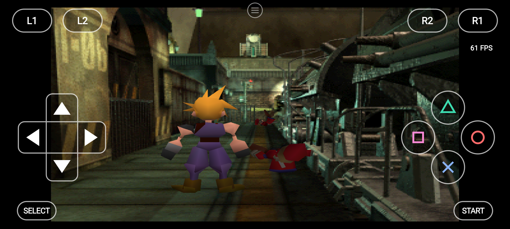
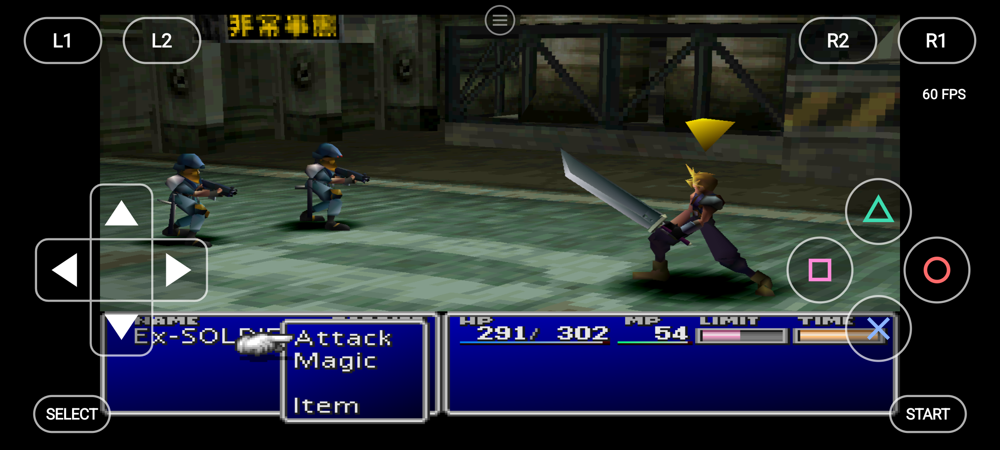
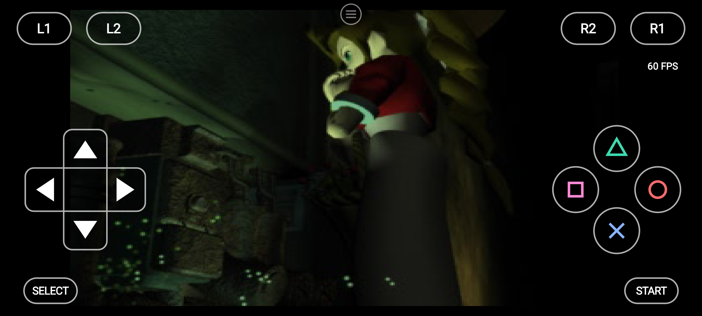
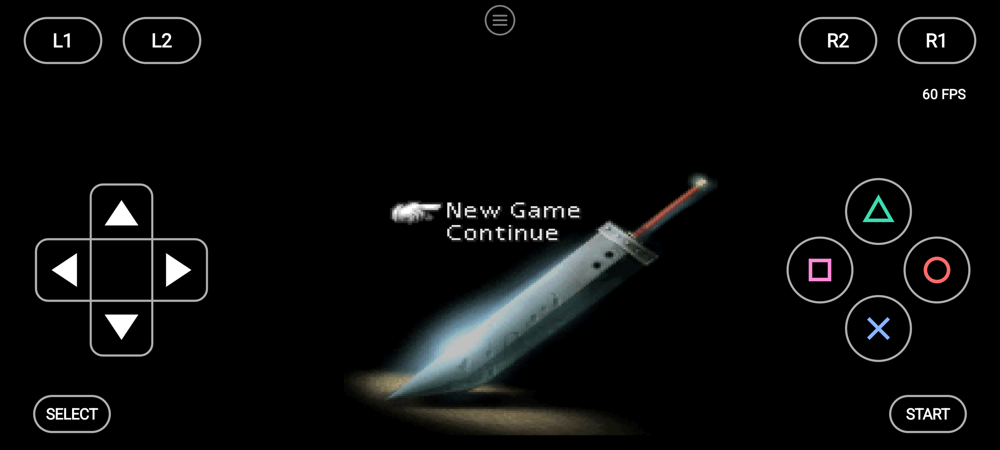
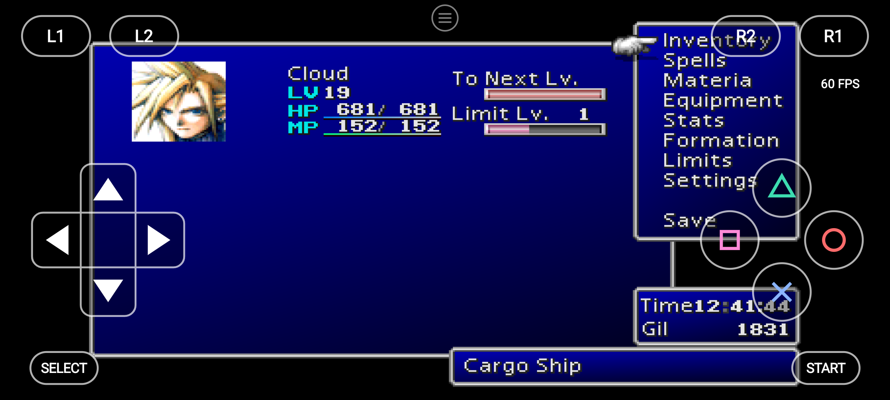
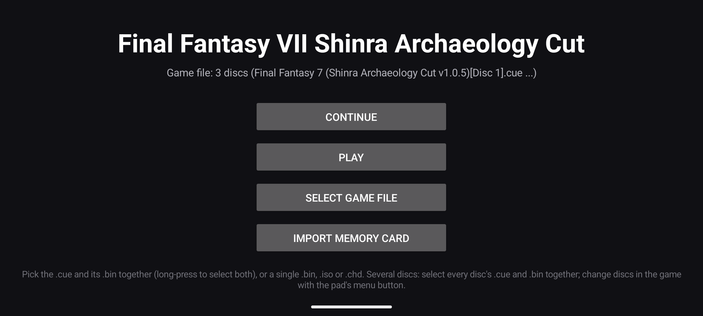

# Final Fantasy VII Shinra Archaeology Cut for Android

A native Android port of **Final Fantasy VII** (PlayStation), in the **Shinra Archaeology Cut v1.0.5** edition, made
by *static recompilation*. The game's main program is translated to C and compiled for your phone ahead of time, and
so is the code FF7 loads from the disc while it plays (the field, battles, the world map, the menus), instead of
being emulated. The rest of the console (graphics, sound, CD drive, controllers) comes from the
[psxrecomp](https://github.com/mstan/psxrecomp) engine with its Android layer
([psxrecomp-android](https://github.com/dguillot-gh/psxrecomp-android)).

> **This repository contains no game data.** You build the game from your own discs: the scripts recompile your
> discs on your PC, and nothing made from them is ever committed or shared. Please do not share the builds you make
> (the build folder and the APK contain the game).

## Pictures

All taken on a **Pixel 8** with this repository's build (OpenGL renderer at 4x, `stable` texture filter), at full
speed: the FPS figure at the right is the game's own counter.

<p>
  
</p>
<p><em>The first field scene, right off the opening train, with the on-screen pad.</em></p>

<p>
  
  
</p>
<p><em>The first battle (left) and the opening movie (right).</em></p>

<p>
  
  
</p>
<p><em>The title screen (left) and the field menu, later on the Cargo Ship (right).</em></p>

<p>
  
</p>
<p><em>The app's start screen: Continue from a save slot, Play, pick your discs, or import a memory card of your own.</em></p>

## Contents

- [Pictures](#pictures)
- [Quick start](#quick-start)
- [What you need](#what-you-need)
- [Building it, step by step](#building-it-step-by-step)
- [Playing on the phone](#playing-on-the-phone)
- [Tested phones and measured speed](#tested-phones-and-measured-speed)
- [What was improved](#what-was-improved)
- [Known issues](#known-issues)
- [What's next](#whats-next)
- [Troubleshooting](#troubleshooting)
- [How it works](#how-it-works)
- [Credits and licence](#credits-and-licence)

## Quick start

```
workspace\
  ff7-android\            (this repository)
  discs\                  your three .cue + .bin pairs (any names)
```

```powershell
git clone --recurse-submodules https://github.com/dguillot-gh/ff7-android.git
pwsh -File ff7-android\scripts\RUN-ALL.ps1 -Install
```

Make an empty folder (the *workspace*), clone into it, put your discs in `discs\` next to the clone, and run
`RUN-ALL.ps1`. It gets the build tools, sets the game up from your discs, pre-compiles FF7's disc code, builds the app
and, with `-Install`, puts it on your phone over USB together with your discs. About an hour the first time on a
12-thread PC (the test run took 30 minutes once the tools were downloaded); a rebuild is much faster.

Then on the phone: open **Final Fantasy VII**, tap **Select game file**, go to **Download > ff7_recomp**, pick all
three `.cue` files, and tap **Play**.

## What you need

- **Your own discs** of Final Fantasy VII Shinra Archaeology Cut v1.0.5, as `.cue` + `.bin` (one `.bin` per disc). The
  scripts find them by SHA-1, so the file names do not matter:

  | Disc | SHA-1 of the `.bin` | Size |
  |---|---|---:|
  | Disc 1 | `d7525bb78c329c74b614e5af91dbe98e20591856` | 742,731,024 bytes |
  | Disc 2 | `7b8b4497554a546139141af81d70247618c9eb77` | 727,953,408 bytes |
  | Disc 3 | `884a7d5a3d8a39a476bbb7254b87dba5b6366faa` | 656,196,240 bytes |

  **The original (retail) FF7?** Not supported yet. The Shinra Archaeology Cut changes the main program, so a build is
  tied to the discs it was made from. Retail FF7 (SCUS-94163/4/5) has the same code layout and should need only its
  own disc hashes and a check of the battle-loading addresses; it has not been tested.
- **A Windows 10 or 11 PC** (64-bit) with **PowerShell 7** and **Git**:
  ```powershell
  winget install Microsoft.PowerShell
  winget install Git.Git
  ```
  About **20 GB** of free disk space and an internet connection for the first run.
- **An Android phone**: Android 8 or newer, 64-bit ARM, OpenGL ES 3.2 for the GPU renderer, and a USB cable with
  **USB debugging** on (Settings > About phone > tap Build number 7 times, then Settings > System > Developer options
  > USB debugging).

## Building it, step by step

`RUN-ALL.ps1` runs these in order and stops at the first that fails. You can also run them one at a time. Every script
takes `-DryRun` (check everything, change nothing) and writes a log to `logs\` in the workspace.

| Step | Script | What it does | Time (first run) |
|---|---|---|---|
| 1 | `scripts\1-INSTALL-TOOLS.ps1` | Downloads Java 17, the Android SDK/NDK/CMake, a portable Python and the llvm-mingw compiler into `tools-cache\` in the workspace, fetches the engine submodule, builds the recompiler. Asks you to accept Google's Android SDK licence first. | 10-20 min (downloads) |
| 2 | `scripts\2-PREPARE.ps1` | Checks your three discs by SHA-1, copies them into the workspace, sets the game up with this repository's tuned config, and recompiles FF7's main program to C. | 2-3 min |
| 3 | `scripts\3-PRECOMPILE.ps1` | Takes FF7's code modules from your discs (field, battle, world map, menus: 42 modules), checks each one, and compiles them for the phone with the NDK. | 8-30 min |
| 4 | `scripts\4-BUILD-ANDROID.ps1` | Builds the app (APK) into `apks\` with Gradle. Downloads SDL3 and the Android libraries the first time. | 20-60 min |
| 5 | `scripts\5-INSTALL-PHONE.ps1` | Backs up the app's memory cards, save states and settings from the phone to `saves-backup\`, installs the APK over USB, copies your discs to the phone's `Download\ff7_recomp`. | 2-3 min |

Useful options:

| Option | Script | Does |
|---|---|---|
| `-Install` | `RUN-ALL` | also runs step 5 |
| `-Serial <id>` | `RUN-ALL`, step 5 | picks the phone when several are connected (`adb devices` lists them) |
| `-Background <picture.jpg>` | `RUN-ALL`, step 2 | a picture of your own on the start screen |
| `-Card <file.mcd>` | step 5 | imports a PS1 memory card of your own (128 KB, e.g. from DuckStation) as card 1; never replaces one the phone already has |
| `-FromPhone` | step 3 | also pulls the code the app recorded while you played, so the next build pre-compiles that too |
| `-AcceptAndroidLicenses` | `RUN-ALL`, step 1 | for unattended builds, once you have read Google's licence |
| `-DryRun` | all | shows what would run, changes nothing |

### What the scripts change on your PC

Everything they make stays in the workspace: `tools-cache\` (the tools), `recomps\` and `android-recomp\` (the game
set up from your discs and its build), `apks\`, `logs\`, `saves-backup\`. Nothing is installed into Windows, no admin
rights are needed, nothing keeps running afterwards, and nothing is uploaded. Tools you already have (Java 17, an
Android SDK with NDK 28.2) are used instead of downloading them. The scripts are plain text: read any of them before
running it.

### Updating

```powershell
cd ff7-android
git pull
git submodule update --init
pwsh -File scripts\RUN-ALL.ps1 -Install
```

Finished parts are skipped; the game's code is generated again only when the engine or `game\game.toml` changed. An
update keeps your saves, save states and settings on the phone. New default settings (`game\game.toml.in`) reach an
app that is already installed only when you tap **Select game file** and pick the discs again; that resets the menu's
settings to the new defaults and leaves saves and save states alone.

## Playing on the phone

- **The pad**: touch controls for every PS1 button. In **Edit pad layout** (in the menu) drag each control where you
  want it, make it smaller or bigger, change its opacity, or hide it. A Bluetooth or USB gamepad works too.
- **The menu** (the ≡ button at the top): renderer (**Software** or **GPU (experimental)**), internal resolution, **Smooth textures**,
  perspective-correct textures, anti-aliasing, the FPS counter, the pad, **save states** (12 slots, each with its
  time), changing discs, restart and quit.
- **Continue**: the start screen's Continue picks up where you left off, from the slot you choose.
- **Your PS1 saves**: the game's own memory card saves work as on a PS1 and are separate from save states. **Import
  memory card** on the start screen brings in a card of your own.
- **Changing discs**: when the game asks for Disc 2 or 3, change it from the menu.

The defaults are the fast settings for older phones (below); every one of them can be changed in the menu.

## Tested phones and measured speed

**Speed** below is the game's own counter: **1.00x = full speed** (60 vblanks a second; FF7 itself draws 30 frames a
second in the field, so 30 FPS on screen *is* full speed there). Measured with the phones' own tools (SurfaceFlinger
frame timing, CPU/GPU clocks, simpleperf profiles) and the runtime's per-second log. On the LG V30 one run can differ
from the next by about 10%, so every result below compares the two builds in alternating runs at the same spot.

### Google Pixel 8 (Tensor G3, Mali-G715, Android 14+)

**Full speed.**

| Date | Build | Result |
|---|---|---|
| 2026-10-07 | first Android build (older engine) | plays; about 50 FPS in the opening movie |
| 2026-11-04 | `stable` texture filter, GPU 4x | **1.00x** |
| 2026-11-04 | **this repository, built from a fresh clone** | **1.00x, 60 FPS** in the field (OpenGL); Continue, saves and settings all fine |
| 2026-11-04 | the same build, played for the pictures above | **1.00x** on the title screen, in the opening movie, the first field scene, the first battle and the Cargo Ship menu |

### LG V30 (Snapdragon 835, Adreno 540, Android 8, 2017)

**Playable, mostly 0.8-0.9x; battles and some menus still dip.** The V30 is the test phone for older hardware: when
the work started (2026-11-02) FF7 ran at about half speed on it. Each row adds one change to the one above it:

| Date | Change | Spot | Before | After |
|---|---|---|---:|---:|
| 11-03 | Starting point: Software renderer | battle | | 0.56-0.65x |
| 11-03 | **Idle-loop skip** (skip FF7's VSync wait loop instead of emulating it) | field + battle, Software | 26.1 FPS | **31.6 FPS (+21%)** |
| 11-03 | **GPU renderer, vsync off** (the engine paces itself) | field + battle | 0.53x | **0.71x** |
| 11-03 | **Upload staging** (no driver stall on every VRAM upload) | standing in the field | 0.643x | **0.708x (+10%)** |
| 11-03 | **GPU list walk** (CPU-held GPU command lists run in one pass) | walk + battle | 0.71x | **0.88x** |
| 11-03 | Raw-mirror blit, client-side vertex arrays | walk + battle | 0.79x | 0.82x, long frame gaps 20 → 5 |
| 11-04 | **"Stable" texture filter** (smooth 3D, sharp 2D) | | seams on backgrounds | **seams gone** |
| 11-04 | GL render thread (optional, see below) | a later save, standing | 0.707x | **0.807x (+14%)** |
| 11-04 | Faster battle loading (`load_accel`) | entering a battle | 0.43-0.48x | 0.53-0.65x |

Where it stands with this repository's defaults: about **0.8-0.9x** at the spot right off the opening train, about
**0.7-0.8x** in heavier areas later on, and **0.6-0.7x** during battles. Audio crackles when it is under full speed.

## What was improved

Work done on this port, with the reason for each (the engine changes are on
[psxrecomp-android `feature/ff7-v30`](https://github.com/dguillot-gh/psxrecomp-android/tree/feature/ff7-v30)):

- **Idle-loop skip for FF7.** FF7 waits for the next frame in a tight loop (PsyQ's `VSync`); emulating that loop
  instruction by instruction was 41-54% of the V30's work in the field. The engine now recognises the loop, including
  FF7's timeout countdown, and skips straight to the next event.
- **GPU renderer for older phones.** Each VRAM upload now gets its own small texture, so the Adreno driver no longer
  copies a 2 MB texture every time (20% of the time, before); uploads reach the GPU's VRAM copy with one blit; textured
  draws use client-side vertex arrays.
- **GPU list walk.** A GPU command list used to be processed one word at a time with a full check of every device per
  word (about 550,000 checks a second); it now runs in one pass up to the next event (65,000 a second).
- **Vsync off by default.** Waiting on the display's vsync blocked every frame on the V30; the engine's own clock still
  keeps the game at the right speed.
- **"Stable" texture filter**: smooth 3D models, sharp backgrounds and text. Plain bilinear filtering drew green
  outlines around FF7's background cut-outs.
- **Faster battle loading**: while the disc loads, the time FF7 spends waiting moves straight to the next event.
- **The phone app**: Continue waits for the disc to boot before loading the state (the V30 takes about 14 seconds), an
  Import memory card button, an optional start-screen picture, and an on-screen pad that redraws only when it changes
  (11% of the app's work while touching the pad before, under 0.1% after).
- **GL render thread** (optional): all GPU work runs on its own thread, next to the game. Off by default for now; to try
  it, add `gl_thread = true` under `[video]` in `game\game.toml.in`, run steps 2, 4 and 5 again, then
  tap **Select game file** on the phone and pick the discs again (see [Updating](#updating)).
- **This repository**: one place to build everything, the copyright guard, and build scripts that also work on locked-
  down PCs (PowerShell's Constrained Language Mode).

## Known issues

- **Under full speed on older phones**: battles and some menus on the LG V30 run at 0.6-0.7x, and the audio crackles
  while the game runs slower than full speed.
- **Dark rectangles where FF7 draws a glow** in some places with the GPU renderer (the Software renderer draws them
  right). Being looked into.
- **Two pieces of FF7's disc code do not pre-compile**; they run on the engine's interpreter (slower, still correct).
- **Faster battle loading is new**: the opening movie plays at full speed with it on the Pixel 8; the other movies and
  older phones have not been checked yet. If a movie misbehaves, remove the `[load_accel.vsync_query]` section from
  `game\game.toml` and build again.
- **Several ports open at once** can run a 4 GB phone out of memory: close other games before playing.
- **Retail FF7** discs are not supported yet (see What you need).

## What's next

- **Asynchronous present** for the GL render thread: in testing it took V30 battles from **0.67x to 0.80-0.90x
  (+26%)** and is planned as the next engine update for this repository, with the render thread on by default.
- The slow menus on the V30.
- The dark-rectangle glow bug in the GPU renderer.
- A full build on a PC with nothing installed, and retail FF7 discs.

## Troubleshooting

| Problem | What to do |
|---|---|
| `disc N of 3 not found` | Check the discs are in `discs\` beside the repository, one `.cue` + `.bin` per disc, and that each `.bin`'s SHA-1 is in the table above (PowerShell: `Get-FileHash <file.bin> -Algorithm SHA1`). |
| `no recompiler yet` | Run `scripts\1-INSTALL-TOOLS.ps1` first. |
| Step 1 stops at the Android SDK licence | Answer `y` to accept Google's licence, or rerun with `-AcceptAndroidLicenses`. |
| `INSTALL_FAILED_UPDATE_INCOMPATIBLE` when installing | The app on the phone was built on another PC (another signing key). Copy that PC's `tools-cache\debug.keystore` into this workspace's `tools-cache\` and build again. Uninstalling the app also works, but **deletes its saves**: back them up first (step 5 does that). |
| The phone is not found | Unlock it, answer "Allow USB debugging", and check `adb devices`; with several phones, pass `-Serial`. |
| The picture looks wrong on your phone | Switch the renderer to **Software** in the menu. |
| A step failed | Its log is in the workspace's `logs\` folder; the last lines name the problem. |

## How it works

The engine's recompiler reads the main program from Disc 1 and writes it as C; Android's NDK compiles that into the
app. FF7 loads most of its code from the disc while it plays (the field, battles, the world map and the menus are
modules loaded at fixed addresses), so `game\tools\overlay_extract.py` takes each module from your discs, checks that
it really is code at that address, and the pre-compile turns it into native code too. At run time a pre-compiled piece
only runs when its bytes match what the game loaded, so a wrong piece can never run wrong code; anything not
pre-compiled runs on the engine's interpreter.

| Folder | What |
|---|---|
| `game/` | FF7's setup: `game.toml` (memory layout, discs, battle-loading settings), `game.toml.in` (the app's default settings), `seeds/` (code entry points), `tools/overlay_extract.py`, `REFERENCE.md` (notes) |
| `scripts/` | the build steps |
| `tools/` | the build tools (from [psx-android](https://github.com/dguillot-gh/psx-android)) and the copyright guard |
| `template/` | the Android app template |
| `framework/` | the engine: [psxrecomp-android](https://github.com/dguillot-gh/psxrecomp-android) (submodule) |
| `docs/images/` | the pictures in this README |

**Never committed**: discs, saves, BIOS images, generated code, APKs, and capture files (they contain the game's
code). `python tools/check_no_game_data.py` checks every tracked file; `--install-hook` makes it run before each commit.

## Credits and licence

The engine is [psxrecomp](https://github.com/mstan/psxrecomp) by mstan, with this project's Android layer
([psxrecomp-android](https://github.com/dguillot-gh/psxrecomp-android)); it is under the **PolyForm Noncommercial
License 1.0.0**: personal, non-commercial use only. The free OpenBIOS from
[PCSX-Redux](https://github.com/grumpycoders/pcsx-redux) (MIT) ships with the engine, so no Sony BIOS is needed. FF7's
module map comes from the [Final-Fantasy-VII](https://github.com/TechnicallyComputers/Final-Fantasy-VII) static recomp
of the retail game. The Shinra Archaeology Cut is a fan edition of FF7 by its own authors; this repository contains
none of it. Details in [NOTICE.md](NOTICE.md).

This repository's own files (the scripts, tools, template and FF7 setup) are MIT ([LICENSE](LICENSE)). *Final Fantasy
VII* is © Square Enix; this project is not affiliated with or endorsed by Square Enix or Sony.
